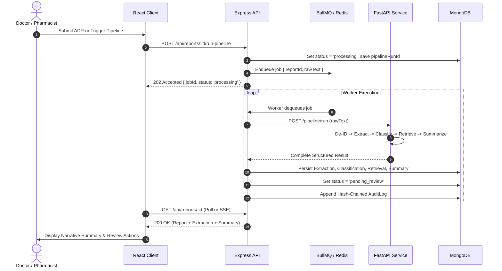
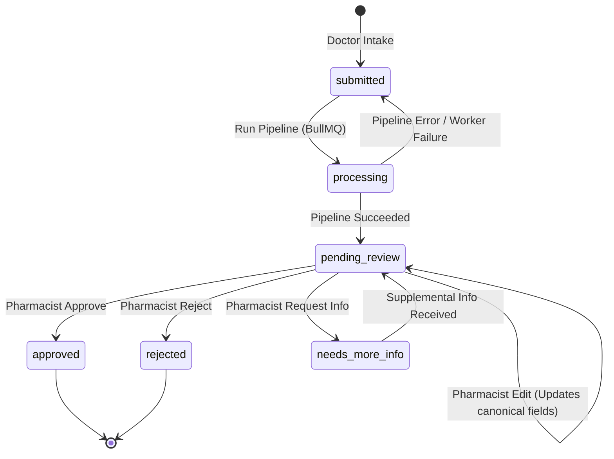

# PharmaGuard: Pharmacovigilance & Drug Safety Intelligence Platform
## Phase 2 Comprehensive Engineering & Clinical Architecture Plan

---

## 1. Executive Summary & MVP Technical Assessment

PharmaGuard is designed as an end-to-end, human-in-the-loop pharmacovigilance (PV) and drug safety intelligence platform. The Phase 1 MVP demonstrates the feasibility of orchestrating multi-stage AI (de-identification, NER extraction, risk classification, vector retrieval, and summarization) with an Express/MongoDB backend and React frontend.

However, an audit of the MVP codebase identifies critical architectural bottlenecks, regulatory compliance gaps, and security vulnerabilities that must be addressed prior to introducing advanced intelligence features.

```
+-----------------------------------------------------------------------------------+
|                               PHARMAGUARD ROADMAP                                 |
+-----------------------------------------------------------------------------------+
| Phase 2A: Fix & Harden (Core Security, Async Pipeline, Persisted Summary, State)  |
| Phase 2D: Eval Harness & Feedback Loop (n2c2/CADEC, Human-AI Diff Curation)      |
| Phase 2C: Intelligence & Analytics (FAERS Signal Detection PRR/ROR, KG, Reranker) |
| Phase 2B: Real PV Depth (ICH E2A Seriousness, WHO-UMC/Naranjo, E2B(R3), Clocks)    |
| Phase 2E: Production Readiness (Field Encryption, SSO/MFA, Tracing, GPU Profiles) |
+-----------------------------------------------------------------------------------+
```

---

## 2. Identified Vulnerabilities & Technical Debt in MVP

| Category | Issue | Code Location | Clinical / Operational Risk |
| :--- | :--- | :--- | :--- |
| **Auth & Security** | Open Admin Registration | `server/src/controllers/authController.js:13-30`<br>`server/src/routes/authRoutes.js:7` | Any unauthenticated user can assign themselves `admin` role in production. |
| **Data Integrity** | Summary Never Saved or Rendered | `server/src/controllers/reportController.js:89`<br>`server/src/models/Report.js`<br>`client/src/pages/ReportDetail.jsx` | AI clinical synthesis is discarded into audit metadata; clinicians never see the narrative explanation. |
| **Performance** | Synchronous RAG Seeding on Every Query | `ml-service/app/pipeline/retrieve.py` | Overheads and network calls to OpenFDA/PubMed block report processing. |
| **Data Quality** | Mock / Fixed Evidence Snippets | `ml-service/app/pipeline/retrieve.py` | Retrieved snippets are static mock strings; queries are not bound to extracted suspect drugs. |
| **UI State Mismatch**| Status Key Discrepancy | `client/src/pages/Dashboard.jsx:6`<br>`client/src/components/Badge.jsx:6`<br>`server/src/controllers/reportController.js:138` | Client expects `request_more_info`; server writes `needs_more_info`. Dashboard tile counter remains 0. |
| **Clinical Triage** | Queue Lacks Severity Sorting | `server/src/controllers/reportController.js:113` | Queue sorts strictly by date (`createdAt: -1`). Critical anaphylaxis/death cases do not surface first. |
| **Architecture** | Synchronous HTTP Pipeline Execution | `server/src/controllers/reportController.js:42`<br>`server/src/utils/mlServiceClient.js:5` | 60s Node timeout against 3 sequential LLM/NER inference calls causes 502/504 gateway timeouts under load. |
| **Review Workflow** | Gaps in Human-in-the-Loop Workflow | `server/src/controllers/reportController.js:118-152`<br>`client/src/pages/ReportDetail.jsx:135-156` | Edit action is missing UI; `editedFields` is never applied to the canonical report or diffed; no state guards. |
| **Ingestion** | Incomplete File Upload Pipeline | `server/src/routes/reportRoutes.js:20`<br>`client/src/pages/Intake.jsx` | `multer` buffers files in memory, but PDF/DOCX text extractors are absent; UI only supports pasted text. |
| **Compliance & Sec**| Missing Hardening Baseline | `docker-compose.yml`, `server/src/index.js`, `ml-service/app/main.py` | Hardcoded JWT secret, unauthenticated report access across doctors, CORS `*`, unverified audit logs, no CI/CD. |

---

## 3. Phase 2A: Fix & Harden (Weeks 1–2)

### 3.1. Authentication, RBAC & Report Access Scoping
1. **Lock Down `/api/auth/register`**:
   - In production (`NODE_ENV === "production"`), disable public registration.
   - For initial deployment, support an `INIT_ADMIN_TOKEN` or a CLI seed command (`npm run seed:admin`).
   - Restrict self-registration to `doctor` role by default if self-registration is enabled; only `admin` can promote or assign `pharmacist` / `admin` / `researcher` roles via `POST /api/users`.
2. **Access Scoping for Doctors**:
   - Update `getReport` in `server/src/controllers/reportController.js`:
     - If `req.user.role === "doctor"`, restrict access to reports where `submittedBy === req.user._id`.
     - Pharmacists, admins, and researchers retain global access.
3. **Environment Security**:
   - Remove hardcoded secrets from `docker-compose.yml`. Require `JWT_SECRET` in `.env`.
   - Add Helmet, rate limiting (`express-rate-limit` on `/api/auth/*` and `/api/reports/*`), and tighten CORS on ML service to accept only requests from internal network/server container.

### 3.2. Asynchronous Job Queue (BullMQ + Redis)
To prevent HTTP 502 timeouts during multi-stage model execution:
- Deploy Redis 7 in `docker-compose.yml`.
- Introduce BullMQ on Express server:
  - Producer: `POST /api/reports/:id/run-pipeline` pushes job `{ reportId }` to `report-processing-queue` and sets status to `processing`. Returns `202 Accepted` with `jobId`.
  - Worker: Processes queue jobs, calls ML service, writes results (`Extraction`, `Classification`, `Retrieval`, `Summary`), updates report status to `pending_review`, and logs audit trail.
  - Client polling or Server-Sent Events (SSE) via `GET /api/reports/:id/pipeline-status` to stream progress bars.



### 3.3. Report State Machine & Review Workflow Guards
Enforce strict lifecycle transitions to prevent approving unprocessed or malformed reports:



- **Validation Rules**:
  - `approve` / `reject` / `request_more_info` / `edit` only permitted when `status === "pending_review"` or `"needs_more_info"`.
  - Cannot transition directly from `submitted` to `approved`.
- **Edit UI & Diffing Engine**:
  - Provide inline editing form in [`ReportDetail.jsx`](file:///Users/prd/.gemini/antigravity/scratch/pharmaguard/client/src/pages/ReportDetail.jsx) for `drugName`, `symptoms`, `dosage`, and `severity`.
  - Store edit operations in `Review.editedFields` and persist an updated canonical `Extraction` version (`version: v2`, `source: "human_review"`).
  - Compute structured diff: `{ field, originalAI, reviewedValue, modifiedBy, timestamp }`.

### 3.4. Summary Persistence & Presentation
- Extend `server/src/models/Report.js` to store:
  - `summary`: String (clinical narrative)
  - `summaryModelVersion`: String
- Update `runReportPipeline` worker to persist `report.summary = result.summary`.
- Update `getReport` controller to return `summary`.
- Render a dedicated **Clinical Narrative & RAG Summary** card with badge indicators in `ReportDetail.jsx`.

### 3.5. Evidence Retrieval Fixes
- Fix collection initialization: check if Qdrant collection has vectors before seeding; do not hit live PubMed/OpenFDA feeds per inference call.
- Extract suspect drug keywords dynamically from `extraction.drugName` and query OpenFDA/PubMed using parameterized queries (`term={drug}[Title/Abstract] AND ("adverse effects" OR "toxicity")`).
- Extract full PubMed abstracts via eFetch XML parsing rather than static placeholders.

### 3.6. Severity-Weighted Queue Ordering
- Update `listReports` controller to join with the latest `Classification` record:
  - Priority sort: `life_threatening` (Weight 4) > `serious` (Weight 3) > `moderate` (Weight 2) > `mild` (Weight 1), secondary sorted by `createdAt DESC`.
  - Add visual urgency chips and drug badges on [`ReviewQueue.jsx`](file:///Users/prd/.gemini/antigravity/scratch/pharmaguard/client/src/pages/ReviewQueue.jsx).

### 3.7. Cryptographic Audit Log (Hash-Chained)
To comply with FDA 21 CFR Part 11 and prevent audit record tampering:
- Each log entry computes `hash = SHA256(prevHash + timestamp + actor + action + reportId + payload)`.
- Mongoose schema middleware blocks `.updateOne()`, `.findOneAndUpdate()`, and `.deleteOne()` on `AuditLog`.
- Add an audit verification utility `verifyAuditIntegrity()` to detect any chain breaks.

### 3.8. Testing, CI & Quality Gates
- **Unit & Integration Tests**:
  - Backend: Jest + Supertest test suite testing Auth, RBAC, State Machine transitions, and Audit Hash chaining.
  - ML Service: Pytest testing Regex PII de-identification, LLM JSON extraction validation, and Qdrant retrieval fallback.
- **CI/CD Pipeline**: GitHub Actions running linting, formatting (`prettier`, `black`, `ruff`), and automated test suites on push/PR.

---

## 4. Phase 2D: Evaluation & Feedback Loop (Next Priority)

*Per clinical guidance, implementing Phase 2D immediately following 2A ensures reviewer corrections become high-value labeled data for model fine-tuning and benchmarking.*

### 4.1. Human-in-the-Loop Feedback & Labeled Dataset Generation
```
Reviewer Edits (ReportDetail UI) ──> Stored Diff in Review Record ──> Gold Standard ADR Dataset
                                                                          │
                                                                          ▼
                                                               Model Benchmarks & Fine-tuning
```
- Each time a clinical pharmacist modifies an extraction or reclassifies severity, save the tuple `(raw_text, ai_output, human_ground_truth)` into a dedicated `FeedbackExample` collection.
- Export endpoints in standard formats: JSONL, CoNLL (for NER tokens), and CSV (for classification).

### 4.2. Evaluation Harness
Build a standalone benchmark pipeline in `ml-service/eval/`:
- **Datasets Supported**:
  1. **n2c2 2018 Track 2** (Adverse Drug Events extraction).
  2. **CADEC** (CSIRO Adverse Drug Event Corpus).
  3. **TAC 2017 ADR**.
- **Metrics Calculated**:
  - **Extraction**: Token and span-level Precision, Recall, Strict F1, and Relaxed F1 for Drugs, Adverse Reactions, Routes, Dosages.
  - **Classification**: Macro/Micro F1, Balanced Accuracy, Cohen's Kappa, Confusion Matrix.
  - **Retrieval**: Mean Reciprocal Rank (MRR@5), Recall@K, Normalized Discounted Cumulative Gain (NDCG@5).
- **Confidence Calibration**:
  - Implement Expected Calibration Error (ECE) and Platt scaling / isotonic regression on classification probabilities to replace raw LLM heuristic confidence scores.

---

## 5. Phase 2C: Intelligence & Analytics

### 5.1. Disproportionality Signal Detection on FAERS (OpenFDA)
Implement industry-standard pharmacovigilance statistical algorithms:
- **Proportional Reporting Ratio (PRR)**:
  $$\text{PRR} = \frac{a / (a + b)}{c / (c + d)}$$
- **Reporting Odds Ratio (ROR)**:
  $$\text{ROR} = \frac{a \cdot d}{b \cdot c}, \quad 95\% \text{ CI} = e^{\ln(\text{ROR}) \pm 1.96 \sqrt{\frac{1}{a} + \frac{1}{b} + \frac{1}{c} + \frac{1}{d}}}$$
- Query live OpenFDA API for aggregate background 2x2 contingency tables and surface safety signals on the Dashboard.

### 5.2. Drug-Event Knowledge Graph
- Model entities: `Drug` $\rightarrow$ `AdverseEvent` $\rightarrow$ `TargetOrgan` $\rightarrow$ `PatientRiskFactor`.
- Persist relationships in Neo4j or lightweight graph structures to identify cross-class adverse effects (e.g., fluoroquinolone-induced tendon rupture or ACE-inhibitor angioedema).

### 5.3. Hybrid Dense + Sparse (BM25) Retrieval & Re-ranking
- Ingest full drug monographs (DailyMed FDA SPL labels) split into 512-token chunks.
- Combine Qdrant dense vector search (Bi-Encoder) with BM25 keyword matching via Reciprocal Rank Fusion (RRF).
- Cross-Encoder Re-ranker (`cross-encoder/ms-marco-MiniLM-L-6-v2`) to re-score top-20 retrieved passages down to top-5 high-relevance clinical citations.

### 5.4. Citation Hallucination Checker
- Summarizer validation layer: Every assertion in the generated clinical summary is matched against the top-5 retrieved passages using Natural Language Inference (NLI / entailment scoring).
- Claims lacking supporting entailment are highlighted or excised.

---

## 6. Phase 2B: Real Pharmacovigilance Regulatory Depth

### 6.1. ICH E2A Seriousness Criteria
Replace the generic 4-tier scale (`mild`, `moderate`, `serious`, `life_threatening`) with official ICH E2A criteria:
- **Seriousness Categories**:
  - Death
  - Life-Threatening
  - Hospitalization (Initial or Prolonged)
  - Persistent or Significant Disability / Incapacity
  - Congenital Anomaly / Birth Defect
  - Medically Significant Event

### 6.2. Algorithmic Causality Assessment
Assist pharmacists with standardized clinical causality frameworks:
- **WHO-UMC Causality Categories**: Certain, Probable, Possible, Unlikely, Conditional/Unclassified, Unassessable.
- **Naranjo Algorithm Questionnaire**: 10 objective scoring questions (dechallenge, rechallenge, previous conclusive reports, alternative causes).

### 6.3. Regulatory Clock & Compliance Tracking
- **15-Day Expedited Alert**: For serious, unexpected ADRs (FDA / EMA IND & post-marketing regulations).
- **7-Day Clock**: For fatal or life-threatening unexpected reactions.
- Automated SLA countdown timers and email/webhook escalation in the review queue.

### 6.4. Regulatory Export & Medical Terminologies
- **E2B(R3) XML Exporter**: Generate compliant ICSR (Individual Case Safety Report) XML for FDA FAERS / EMA EudraVigilance submission.
- **Terminology Mapping**:
  - Suspect / Concomitant Drugs $\rightarrow$ **RxNorm** (RxCUI) & WHO-ATC.
  - Adverse Events $\rightarrow$ **MedDRA** (Lowest Level Term LLT, Preferred Term PT, System Organ Class SOC) or **SNOMED-CT**.

---

## 7. Phase 2E: Production Readiness & Enterprise Security

1. **Field-Level Encryption for PHI**:
   - AES-256-GCM field encryption for patient name, raw unredacted text, MRN, and contact information.
   - Separate encryption keys rotated via environment management / KMS.
2. **Enterprise Authentication**:
   - OAuth2 / OpenID Connect (OIDC) integration for hospital SSO (Okta, Azure AD).
   - Time-based One-Time Password (TOTP) MFA for Pharmacists and Admins.
3. **Multi-Format Intake**:
   - Ingestion worker supporting PDF (via `pdfminer` / `pypdf`), DOCX (via `python-docx`), and scanned clinical documents (Tesseract OCR / AWS Textract).
4. **Observability & Deployment**:
   - Structured JSON logging with trace IDs propagating from Express to ML Service.
   - Prometheus metrics endpoint + OpenTelemetry tracing.
   - Docker Compose profiles: default CPU mode vs. `compose.gpu.yml` utilizing NVIDIA container runtime for local 8B model inference.

---

## 8. Detailed Execution Plan: Phase 2A Breakdown

```
Phase 2A Implementation Tasks:
├── Task 1: Auth Lockdown & Access Scoping (Register lock, Doctor isolation, Rate limits)
├── Task 2: Data Model Updates & Persistence (Summary field, Report state enum, Audit chaining)
├── Task 3: Asynchronous Pipeline Architecture (BullMQ + Redis setup, Worker, Polling endpoint)
├── Task 4: Evidence Engine Real Seeding & PubMed Integration (Drug-specific retrieval, eFetch)
├── Task 5: UI/UX Fixes (Status key synchronization, Summary display, Severity queue sorting)
├── Task 6: Reviewer Edit Workflow & AI Diff Engine (Inline edit UI, Change capture)
└── Task 7: CI/CD & Automated Test Suites (Jest, Pytest, GitHub Actions)
```

### Sprint Backlog & Acceptance Criteria (Phase 2A)

#### Sprint 1: Critical Fixes, Security & Async Core
- **Task 1.1**: Lock down `/api/auth/register` to admin-only or disable in non-development environments.
- **Task 1.2**: Restrict `getReport` so doctors can only view their own submissions.
- **Task 1.3**: Add `summary` attribute to `Report` schema and return it in `getReport`.
- **Task 1.4**: Fix status mismatch between client (`request_more_info` $\rightarrow$ `needs_more_info`) and update `Dashboard.jsx` and `Badge.jsx`.
- **Task 1.5**: Set up Redis and BullMQ queue in Express to make pipeline processing non-blocking.
- **Task 1.6**: Refactor `ml-service/app/pipeline/retrieve.py` to prevent redundant re-seeding and wire drug-specific queries.

#### Sprint 2: Workflow Hardening, Severity Sorting & Quality
- **Task 2.1**: Implement severity-weighted sorting in `listReports` controller and update `ReviewQueue.jsx`.
- **Task 2.2**: Implement strict report state machine transitions in `reportController.js`.
- **Task 2.3**: Build Review Edit UI in `ReportDetail.jsx` and persist human edits alongside original AI predictions.
- **Task 2.4**: Implement SHA-256 hash chaining on `AuditLog` collection with tamper-check verification.
- **Task 2.5**: Write backend Jest tests for auth, state machine, and audit log.
- **Task 2.6**: Write ML service pytest tests for de-identification and schema validation.
- **Task 2.7**: Configure GitHub Actions workflow `.github/workflows/ci.yml`.

---

## 9. Implementation Status Tracker

| Milestone | Scope | Status | Verification & Test Coverage |
| :--- | :--- | :--- | :--- |
| **Phase 2A** | Fix & Harden (Auth lockdown, async BullMQ, persisted summary, audit hash-chaining) | **COMPLETED** | 8 backend tests passing; 4 pipeline unit tests passing; CI workflow configured. |
| **Phase 2D** | Evaluation & Feedback Loop (n2c2/CADEC harness, ECE calibration, diff dataset curation) | **COMPLETED** | `harness.py` running benchmark cases; F1 1.0 on suspect drugs; feedback export API live. |
| **Phase 2C** | Intelligence & Analytics (FAERS signal detection PRR/ROR/Evans/IC, Knowledge Graph, BM25+RRF, Citation validation) | **COMPLETED** | `signals.py`, `knowledge_graph.py`, `citation_checker.py`, `retrieve.py` BM25+RRF; full interactive Dashboard UI. |
| **Phase 2B** | Real PV Regulatory Depth (ICH E2A criteria, Naranjo/WHO-UMC causality, E2B(R3) XML, 7/15-day clocks, duplicate detection) | **COMPLETED** | 12 backend unit tests passing; 12 ML service unit tests passing; E2B export endpoint live; Review queue SLA timers live. |
| **Phase 2E** | Production Readiness (Field encryption, TOTP MFA, Document parser, Tracing, GPU profiles) | **COMPLETED** | 21 backend unit tests passing; AES-256-GCM PHI encryption verified; TOTP RFC 6238 verified; compose.gpu.yml ready. |


