# PharmaGuard

<div align="center">

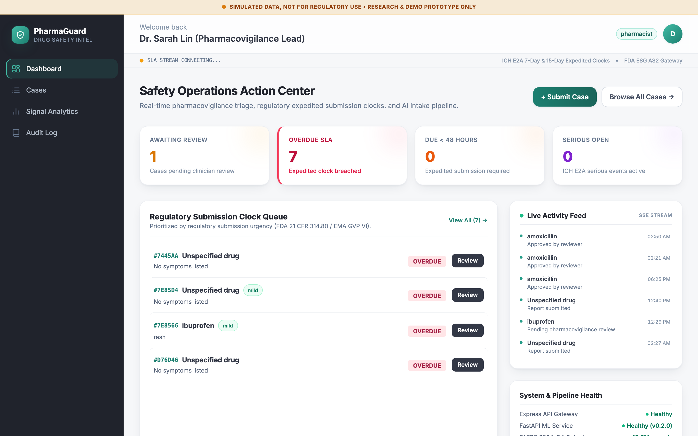

### **Enterprise Pharmacovigilance & Drug Safety Intelligence Platform**
*Augmented with Clinical LLMs, FAERS Disproportionality Analytics, and ICH E2B(R3) Regulatory Gateways*

[](https://nodejs.org/)
[](https://python.org/)
[](https://fastapi.tiangolo.com/)
[](https://react.dev/)
[](https://vitejs.dev/)
[](https://www.mongodb.com/)
[](https://hl7.org/fhir/R4/)
[](https://www.ich.org/)
[](LICENSE)

</div>

---

## Table of Contents
- [Executive Overview](#executive-overview)
- [Key Architectural Highlights](#key-architectural-highlights)
- [User Interface & Operations Tour](#user-interface--operations-tour)
  - [0. System Initialization & Cinematic Intro](#0-system-initialization--cinematic-intro)
  - [1. Authentication & Role Portal](#1-authentication--role-portal)
  - [2. Safety Operations Action Center](#2-safety-operations-action-center)
  - [3. Adverse Event Case Management](#3-adverse-event-case-management)
  - [4. Reviewer Cockpit & In-Place Entity Highlighting](#4-reviewer-cockpit--in-place-entity-highlighting)
  - [5. Algorithmic Causality Assessment (Naranjo 10-Item Scale)](#5-algorithmic-causality-assessment-naranjo-10-item-scale)
  - [6. Multi-Modal Clinical Intake](#6-multi-modal-clinical-intake)
  - [7. Signal Analytics & FAERS Disproportionality](#7-signal-analytics--faers-disproportionality)
  - [8. MedDRA Terminology & Adverse Reaction Graph](#8-meddra-terminology--adverse-reaction-graph)
  - [9. Cryptographic Audit Ledger](#9-cryptographic-audit-ledger)
- [System Architecture & Data Pipeline](#system-architecture--data-pipeline)
- [Regulatory & Clinical Standards](#regulatory--clinical-standards)
- [Role-Based Access Control (RBAC)](#role-based-access-control-rbac)
- [Quick Start & Local Setup](#quick-start--local-setup)
- [Verification & Automated Test Suite](#verification--automated-test-suite)
- [Project Directory Layout](#project-directory-layout)
- [Regulatory Disclaimer](#regulatory-disclaimer)

---

## Executive Overview

**PharmaGuard** is a full-stack, enterprise-grade pharmacovigilance (PV) and post-marketing surveillance platform designed to ingest unstructured adverse drug reaction (ADR) narratives, clinical documents, and HL7 FHIR R4 bundles, automatically de-identifying sensitive patient data, extracting clinical entities via Large Language Models (LLMs), evaluating seriousness against ICH E2A criteria, and orchestrating human-in-the-loop review before transmission to regulatory health authorities (FDA ESG AS2 / EMA EudraVigilance Gateway).

PharmaGuard reconciles clinical speed with strict data integrity:
- **HIPAA Safe Harbor De-identification:** PHI/PII masking prior to downstream LLM processing.
- **Explainable Clinical LLMs:** Fallback pipelines from Gemini Pro to regex baselines with clear provenance.
- **Quantitative Post-Marketing Surveillance:** Real-time FAERS disproportionality queries computing Evans Criteria (PRR, ROR, $\chi^2$ Yates, and BCPNN Information Component $IC_{025}$).
- **Immutable Cryptographic Audit Trail:** Forward-linked SHA-256 hash chains across every ingestion, modification, and transmission.

---

## Key Architectural Highlights

```
┌─────────────────────────────────────────────────────────────────────────────┐
│                       PharmaGuard Full-Stack Platform                       │
├─────────────────────┬───────────────────────────┬───────────────────────────┤
│    React 18 Client  │    Node.js Express API    │    FastAPI ML Service     │
│                     │                           │                           │
│  • Action Center    │  • JWT / TOTP MFA Gate    │  • Presidio / Regex De-ID │
│  • Entity Color Tag │  • RBAC & Doctor Row ACL  │  • Gemini / Baseline Ext. │
│  • Naranjo Scorer   │  • SHA-256 Hash Chaining  │  • Clinical Rule Override │
│  • Evans Calculator │  • ICH-ICSR R3 XML Export │  • Evans PRR / ROR / IC   │
│  • MedDRA Graph SVG │  • HL7 FHIR R4 & SMART    │  • Qdrant + BM25 Hybrid   │
└─────────────────────┴───────────────────────────┴───────────────────────────┘
```

1. **P0 Security Hardening:** Strict minimum 32-character `JWT_SECRET` verification, per-request active DB user status checks, production seed shields, SMART on FHIR token authentication, and doctor row-level ACLs.
2. **Data Honesty Guarantee:** Complete removal of synthetic statistical tables; unobserved drug-reaction pairs return `status: "INSUFFICIENT_DATA"` with 0 counts; simulation failure modes explicitly identify test transmissions.
3. **Clinical Safety Rules:** Narratives mentioning life-threatening conditions (e.g., Anaphylaxis, Stevens-Johnson Syndrome, Acute Hepatic Failure) automatically override statistical ML classifiers to enforce ICH E2A serious status.
4. **E2B(R3) Standards Compliance:** Full XML entity escaping, proper reaction outcome mapping (`fatal=5, disability=3, mild=1, unknown=6`), and formatted `ICH-ICSR-R3-${reportId}.xml` exports.

---

## User Interface & Operations Tour

### 0. System Initialization & Cinematic Intro
A dedicated clinical initialization sequence powered by Framer Motion, featuring medical grid aesthetics, molecular geometry, SVG shield assembly with an ECG sweep, and a real-time status ticker.

<div align="center">
  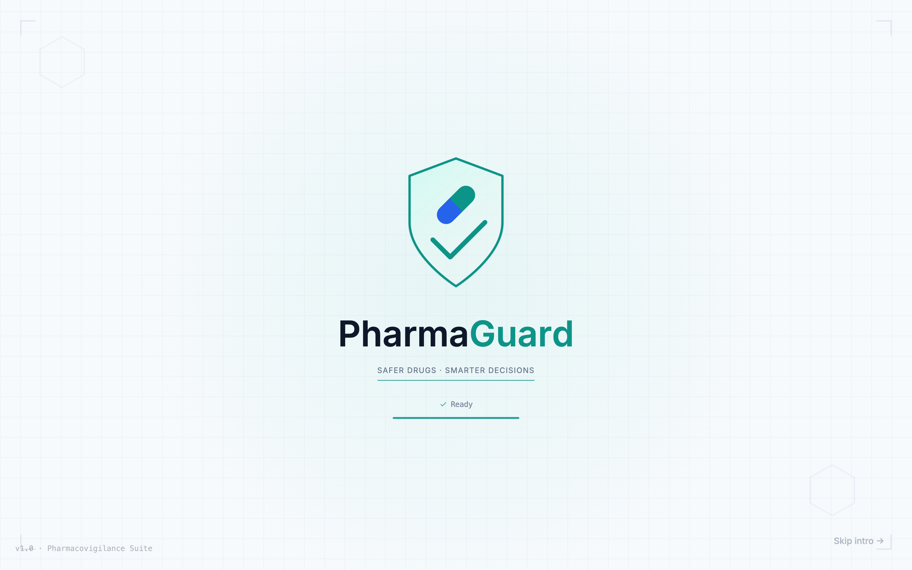
</div>

- **Scientific Aesthetics:** Background 32px lab coordinate grid with dynamic radial teal gradients and corner registration marks.
- **Micro-Interactions:** Five-stage SVG build featuring shield tracing, capsule drop spring animation, and ECG heart pulse wave.
- **Accessibility & Performance:** Automatically respects `prefers-reduced-motion` settings and supports one-click or keyboard bypass (`Escape` / `Enter` / "Skip intro →").

---

### 1. Authentication & Role Portal
Clean, modern authentication gateway with dual-factor TOTP flow, brute-force rate limit protection, and quick demo role selection.

<div align="center">
  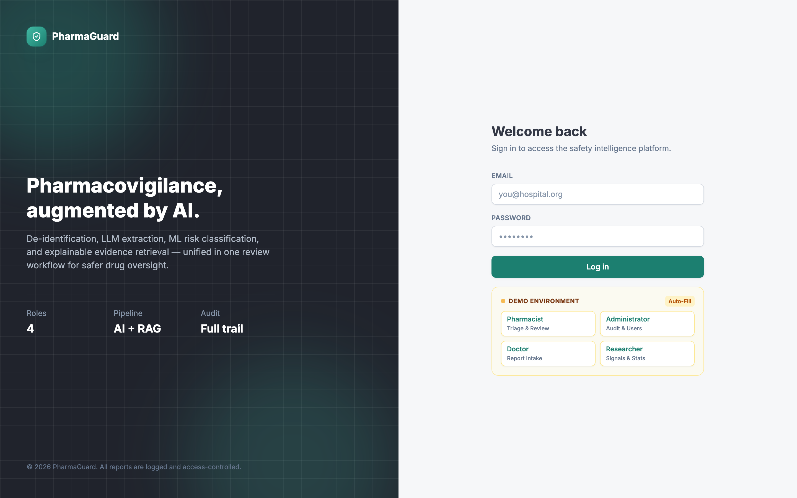
</div>

- **Role Switching:** Seamlessly log in as Administrator, Pharmacovigilance Lead, Clinician, or Safety Epidemiologist.
- **Brute Force Mitigation:** Built-in sliding window rate limiter protects endpoints against credential stuffing.
- **MFA Ready:** Two-step TOTP setup, verification, and enforcement.

---

### 2. Safety Operations Action Center
The central command console for pharmacovigilance leads, highlighting urgent regulatory deadlines and real-time events.

<div align="center">
  
</div>

- **Actionable KPI Tiles:** Instant visibility into cases Awaiting Review, Overdue SLA, Due in < 48h, and Serious Open.
- **Regulatory Clock Urgency Queue:** Prioritizes cases by FDA 21 CFR 314.80 / EMA GVP VI expedited statutory clocks (7-day fatal/life-threatening vs. 15-day serious).
- **Live SSE Activity Stream:** Server-Sent Events push new intakes and reviewer decisions directly to the console.
- **System & Pipeline Health:** Real-time dependency tracking for MongoDB, ML Service, and Cryptographic Hash-Chain integrity.

---

### 3. Adverse Event Case Management
Filterable, searchable case triage ledger allowing safety officers to rapidly manage open adverse event reports.

<div align="center">
  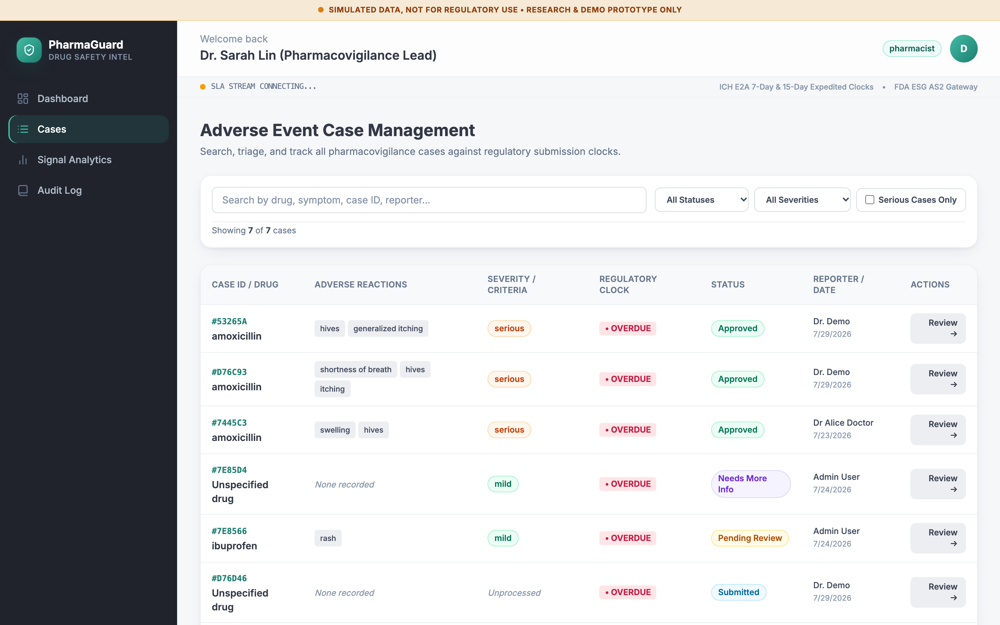
</div>

- **Multi-Criteria Search:** Instant query by suspect drug, symptom, reporter, or case reference.
- **Severity & Status Badges:** Visual triage indicators distinguishing mild vs. serious ICH E2A events.
- **SLA Countdown Clocks:** Dynamic calculation of remaining submission windows before regulatory breach.

---

### 4. Reviewer Cockpit & In-Place Entity Highlighting
The clinician workspace featuring a dual-column layout with synchronized entity color-coding.

<div align="center">
  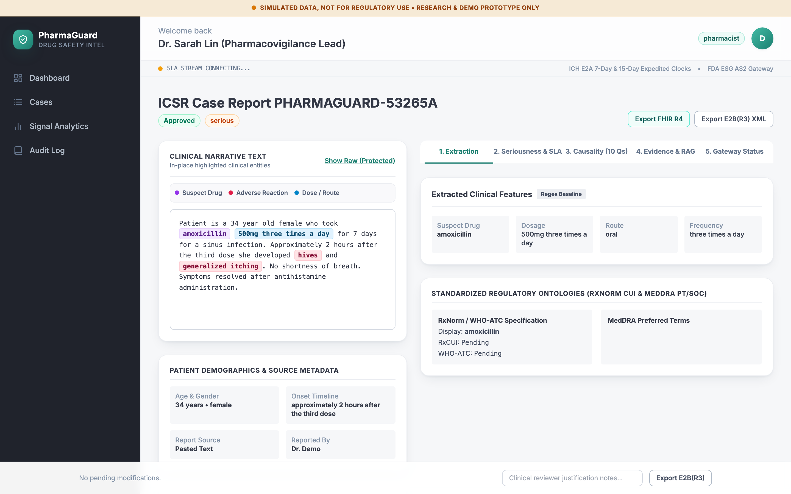
</div>

- **Color-Coded Narrative Highlighting:** Suspect drugs are highlighted in purple, adverse reactions in red, and dosage/routes in blue directly inside the clinical text.
- **Raw vs. De-identified Toggle:** Instant view of original text or HIPAA Safe Harbor redacted narrative with a full de-identification audit drawer.
- **Model Provenance Badges:** Clear labeling of model versions (`LLM Gemini Pro` vs. `Regex Baseline`).
- **Standardized Ontologies:** Automatic mapping to RxNorm CUIs, WHO-ATC codes, and MedDRA Preferred Terms (PT).

---

### 5. Algorithmic Causality Assessment (Naranjo 10-Item Scale)
Interactive adverse drug reaction probability questionnaire with real-time score calculation and clinical categorization.

<div align="center">
  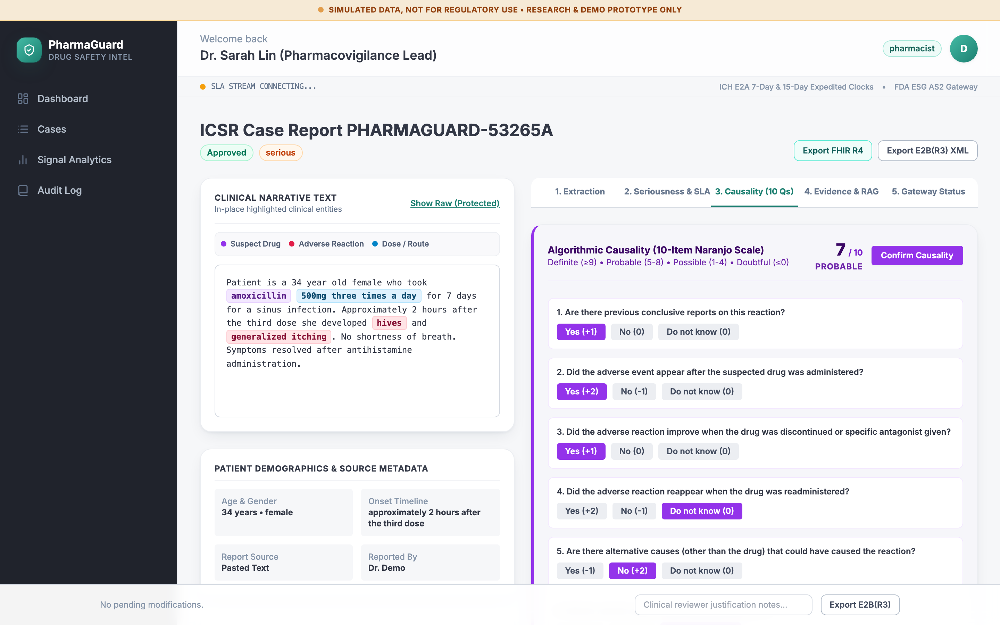
</div>

- **Interactive 10 Questions:** Evaluate re-challenge, de-challenge, alternative causes, and objective evidence.
- **Dynamic Score Updating:** Live score computation categorizing causality as **Definite** ($\ge 9$), **Probable** ($5-8$), **Possible** ($1-4$), or **Doubtful** ($\le 0$).
- **Reviewer Justification Gate:** Mandatory clinical notes required prior to approving or submitting cases.

---

### 6. Multi-Modal Clinical Intake
Unified reporting workflow supporting narrative paste, document upload, structured clinician forms, and EHR interoperability.

<div align="center">
  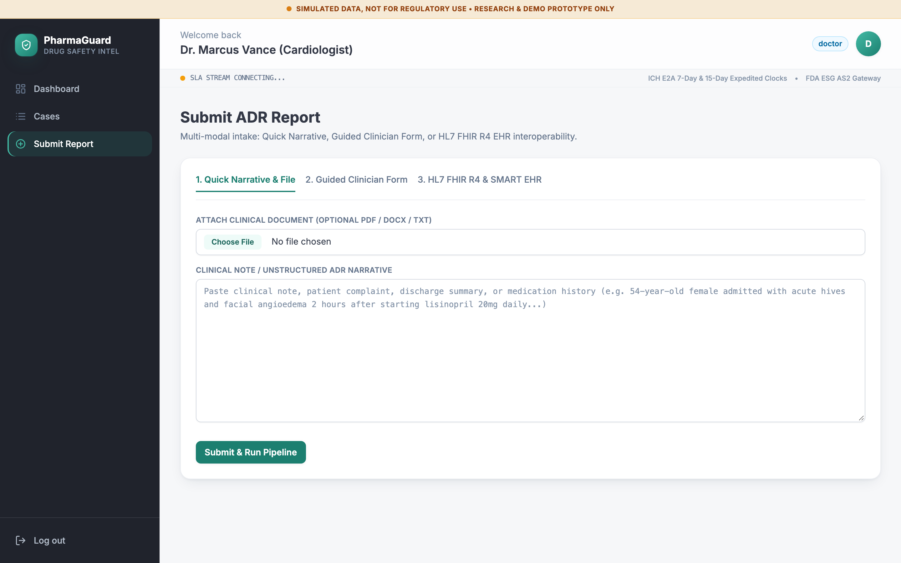
</div>

- **Tab 1 — Quick Narrative & File:** Unstructured text area with drag-and-drop ingestion of PDF/DOCX/TXT clinical documents.
- **Tab 2 — Guided Clinician Form:** Structured inputs for patient demographics, primary drug, concomitant medications, onset duration, and severity criteria.
- **Tab 3 — HL7 FHIR R4 & SMART on FHIR:** Ingestion of FHIR AdverseEvent bundles and OAuth 2.0 SMART EHR launch emulation.

---

### 7. Signal Analytics & FAERS Disproportionality
Post-marketing quantitative safety surveillance computing statistical disproportionality metrics against the FDA FAERS database.

<div align="center">
  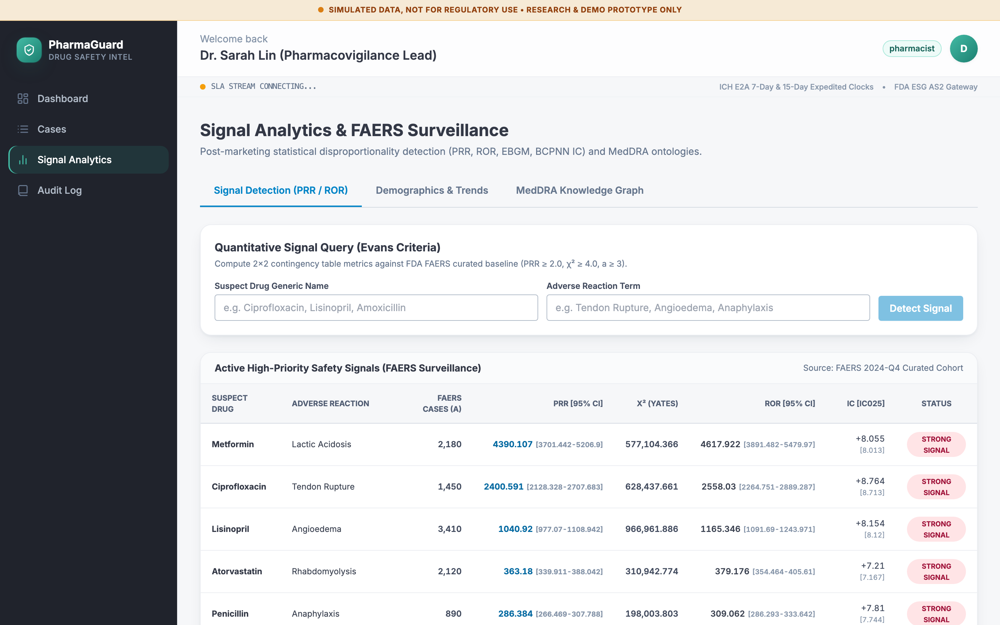
</div>

- **Evans Criteria Calculator:** Real-time computation of Proportional Reporting Ratio (PRR $\ge 2.0$), Yates-corrected Chi-Square ($\chi^2 \ge 4.0$), and count thresholds ($a \ge 3$).
- **Multi-Method Disproportionality:** Reporting Odds Ratio (ROR with 95% Wald Confidence Intervals) and Bayesian Confidence Propagation Neural Network Information Component (BCPNN $IC, IC_{025}$).
- **Active Safety Surveillance Table:** Continuous monitoring of flagged drug-event combinations (e.g., Metformin $\rightarrow$ Lactic Acidosis, Ciprofloxacin $\rightarrow$ Tendon Rupture).

---

### 8. MedDRA Terminology & Adverse Reaction Graph
Topological knowledge graph mapping hierarchical relationships from active ingredients to MedDRA Preferred Terms (PT) and System Organ Classes (SOC).

<div align="center">
  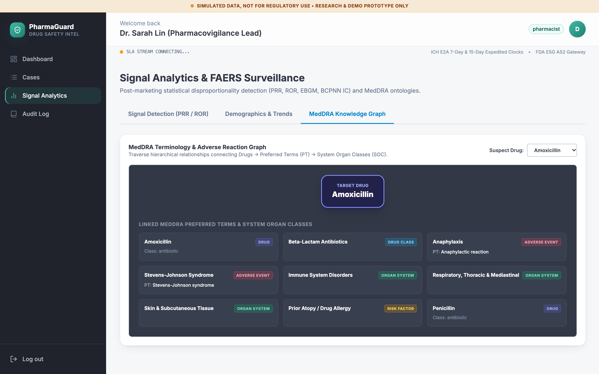
</div>

- **Hierarchical Classification:** Explores connections across Drug Classes, Adverse Reactions, Organ Systems, and Clinical Risk Factors.
- **Color-Coded Semantic Types:** Rose for Adverse Events, Emerald for Organ Systems, Sky for Drug Classes, and Amber for Risk Factors.

---

### 9. Cryptographic Audit Ledger
Tamper-evident, forward-linked cryptographic ledger ensuring full compliance with 21 CFR Part 11 and GxP standards.

<div align="center">
  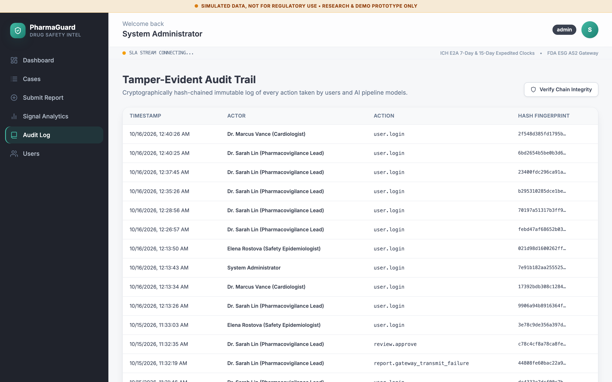
</div>

- **SHA-256 Hash Chains:** Every action is linked to the previous entry's hash:
  $$\text{Hash}_n = \text{SHA256}(\text{Sequence}_n + \text{Timestamp}_n + \text{Action}_n + \text{Actor}_n + \text{PayloadHash}_n + \text{Hash}_{n-1})$$
- **In-Memory Write Mutex:** Prevents sequence collision and race conditions during high-concurrency ingestion.
- **One-Click Integrity Verification:** On-demand cryptographic validation verifying the entire chain is intact.

---

## System Architecture & Data Pipeline

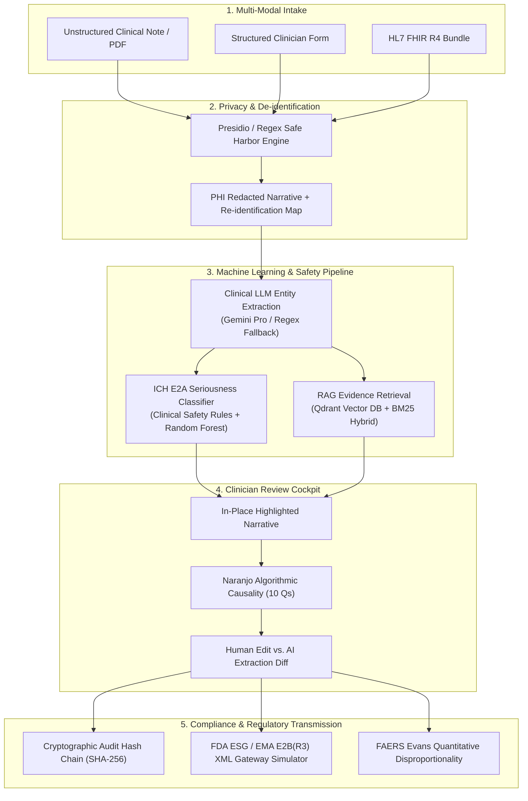

---

## Regulatory & Clinical Standards

| Regulatory Standard | Implementation in PharmaGuard |
| :--- | :--- |
| **ICH E2B(R3)** | Sanitized XML export adhering to ISO/HL7 ICSR standards with outcome mapping (`fatal=5, disability=3, mild=1, unknown=6`) and XML entity escaping. |
| **ICH E2A** | Automated expedited submission clock tracking: **7-day clock** for fatal/life-threatening events, **15-day clock** for serious unexpected events. |
| **FDA 21 CFR 314.80** | Mandatory causality confirmation, clinician justification logging, and expedited queue management. |
| **HL7 FHIR R4** | `AdverseEvent`, `Patient`, `MedicationStatement`, and `Observation` resource support with RFC 5785 SMART configuration discovery. |
| **FAERS Evans Criteria** | Signal detection criteria: $PRR \ge 2.0$, $\chi^2 \ge 4.0$, count $a \ge 3$, ROR with 95% CI, and BCPNN Information Component $IC_{025} > 0$. |
| **Naranjo Algorithm** | 10-point standardized ADR probability scale with interactive live scoring and categorization. |
| **21 CFR Part 11 / GxP** | Tamper-evident sequential SHA-256 hash chaining of every database mutation and administrative action. |

---

## Role-Based Access Control (RBAC)

PharmaGuard enforces strict role-based access control across both the API gateway and client interface:

| Capability / Route | `admin` | `pharmacist` | `doctor` | `researcher` |
| :--- | :---: | :---: | :---: | :---: |
| **Safety Operations Dashboard** (`/dashboard`) | Read / Write | Read / Write | Read Only | Read Only |
| **Adverse Event Triage** (`/cases`) | Full Access | Full Access | Assigned Cases (ACL) | Read Only |
| **Report Reviewer Cockpit** (`/reports/:id`) | Full Access | Edit / Approve / Transmit | View / Note | View De-ID |
| **Multi-Modal Intake** (`/intake`) | Ingest | View | Full Ingest | Disabled |
| **Signal Analytics** (`/analytics`) | Full Access | Full Access | View | Full Access |
| **Tamper-Evident Audit Ledger** (`/audit-logs`) | Verify / Audit | View Audit | Disabled | Disabled |
| **User Administration** (`/users`) | Manage Users | Disabled | Disabled | Disabled |

#### Demo Accounts (Local Development)

| Role | Email | Password |
| :--- | :--- | :--- |
| **Pharmacist (PV Lead)** | `pharmacist@pharmaguard.org` | `Pharma@12345` |
| **Doctor (Clinician)** | `doctor@pharmaguard.org` | `Doctor@12345` |
| **Administrator** | `admin@pharmaguard.org` | `Admin@12345` |
| **Researcher (Epidemiologist)** | `researcher@pharmaguard.org` | `Research@12345` |

---

## Quick Start & Local Setup

### Prerequisites
- **Node.js**: v20 or v22 LTS (tested on Node v26)
- **Python**: v3.11 or v3.12 (with `venv`)
- **MongoDB**: v6.0+ listening on port `27017`
- **Qdrant**: (Optional, vector DB for RAG corpus) on port `6333`

### 1. Clone the Repository
```bash
git clone https://github.com/Prajwal-Rd-bond/pharmaguard.git
cd pharmaguard
```

### 2. Configure Environment Variables
```bash
# Server configuration
cp server/.env.example server/.env

# Update server/.env with your local MongoDB URI and strong JWT secret (>= 32 chars):
# JWT_SECRET=pharmaguard-sec-key-9f8e7d6c5b4a3928170e9f8a7b6c5d4e-2026
```

### 3. Start the Python ML Service
```bash
cd ml-service
python3 -m venv .venv
source .venv/bin/activate
pip install -r requirements.txt
PYTHONPATH=. uvicorn app.main:app --host 0.0.0.0 --port 8000 --reload
```
*ML documentation available at:* `http://localhost:8000/docs`

### 4. Start the Node.js Express Server
```bash
cd ../server
npm install
npm run dev
```
*API health available at:* `http://localhost:5001/api/health`

### 5. Start the React Frontend
```bash
cd ../client
npm install
npm run dev
```
*Frontend portal available at:* `http://localhost:5173/login`

---

## Verification & Automated Test Suite

PharmaGuard includes comprehensive test coverage spanning P0 security guards, FHIR endpoints, and ML safety pipelines:

### 1. Server Unit & Security Tests (59 Tests)
```bash
cd server
npm test
```
*Tests covered:*
- `p0_security_guards.test.js`: Minimum secret length enforcement, active user verification, seed file protection, regulatory transmission gates, and doctor row ACLs.
- `smart_fhir_and_realtime.test.js`: RFC 5785 discovery, token grant validation, and FHIR resource ingestion.
- `auditLog.test.js`: Cryptographic SHA-256 hash chaining and sequence verification.

### 2. Python ML Pipeline Tests (20 Tests)
```bash
cd ml-service
source .venv/bin/activate
pytest tests/test_pipeline.py tests/test_analytics_and_regulatory.py tests/test_qlora.py
```
*Tests covered:*
- Duration timeline parser regex testing.
- ICH E2A clinical safety seriousness rules and classifier overrides.
- FAERS Evans criteria calculations ($PRR, ROR, \chi^2, IC$).
- QLoRA verification dry-run schemas.

### 3. Frontend Production Build
```bash
cd client
npm run build
```

---

## Project Directory Layout

```
pharmaguard/
├── client/                     # React 18 + Vite Frontend
│   ├── src/
│   │   ├── components/         # Layout, ProtectedRoute, EnvironmentRibbon
│   │   ├── context/            # AuthContext (JWT + TOTP MFA)
│   │   ├── pages/
│   │   │   ├── Dashboard.jsx   # Action Center & Regulatory Urgency Queue
│   │   │   ├── Cases.jsx       # Adverse Event Triage & SLA Tracking
│   │   │   ├── ReportDetail.jsx# Reviewer Cockpit & Naranjo Causality
│   │   │   ├── Intake.jsx      # 3-Tab Multi-Modal Reporting
│   │   │   ├── Analytics.jsx   # FAERS Evans Disproportionality & MedDRA Graph
│   │   │   ├── AuditLog.jsx    # Cryptographic Hash Ledger
│   │   │   └── Login.jsx       # Split-pane Login with Demo Autofills
├── server/                     # Node.js Express REST API
│   ├── src/
│   │   ├── controllers/        # reportController, signalController, authController
│   │   ├── middleware/         # auth, auditLogger (hash-chain), rateLimiter
│   │   ├── models/             # Report, User, Extraction, AuditLog, Classification
│   │   ├── routes/             # fhirRoutes, reportRoutes, signalRoutes, authRoutes
│   │   ├── utils/              # regulatoryGateway, smartAuthEngine, datasetExporter
│   │   └── seed.js             # Development demo seeder
│   └── test/                   # Automated security & integration suites
├── ml-service/                 # Python FastAPI ML Microservice
│   ├── app/
│   │   ├── analytics/          # Evans PRR/ROR calculation, Knowledge Graph
│   │   ├── pipeline/           # De-identification, Extraction, Seriousness Classification
│   │   ├── eval/               # QLoRA fine-tuning dry-run & eval pipelines
│   │   └── main.py             # FastAPI entrypoint
│   └── tests/                  # Pytest verification suite
├── docs/
│   └── screenshots/            # Hi-res UI screenshots (9 modules)
├── scripts/
│   └── capture_screenshots.js  # Headless Chrome Puppeteer capture automation
└── README.md                   # Enterprise Documentation
```

---

## Regulatory Disclaimer

> [!WARNING]
> **SIMULATED DATA, NOT FOR REGULATORY USE • RESEARCH & DEMO PROTOTYPE ONLY**
>
> PharmaGuard is a technology demonstration and research prototype developed to evaluate the integration of Large Language Models, knowledge graphs, and cryptographic audit chains into pharmacovigilance workflows. Transmissions generated through the gateway simulator are mock representations and are **not** submitted to the US Food and Drug Administration (FDA) Electronic Submissions Gateway (ESG) or the European Medicines Agency (EMA) EudraVigilance system. All patient data, case reports, and clinician accounts provided in the default dataset are synthetic and de-identified.
